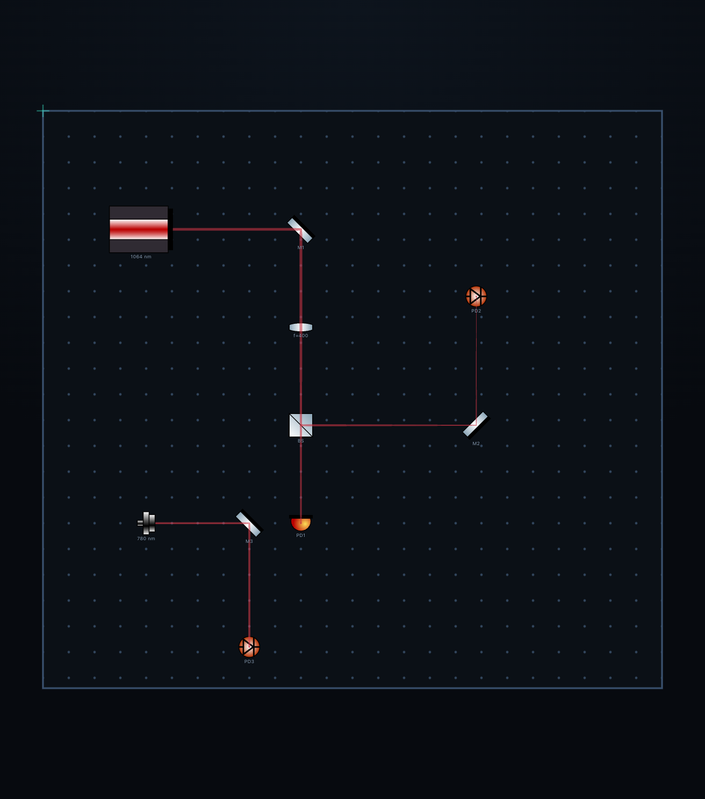
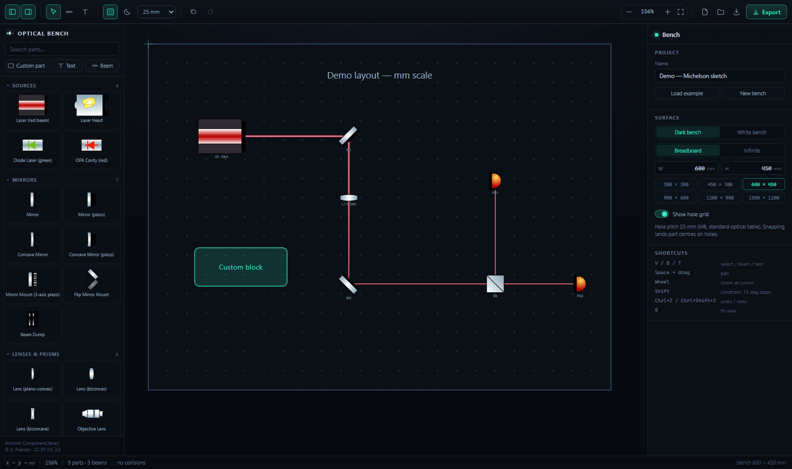
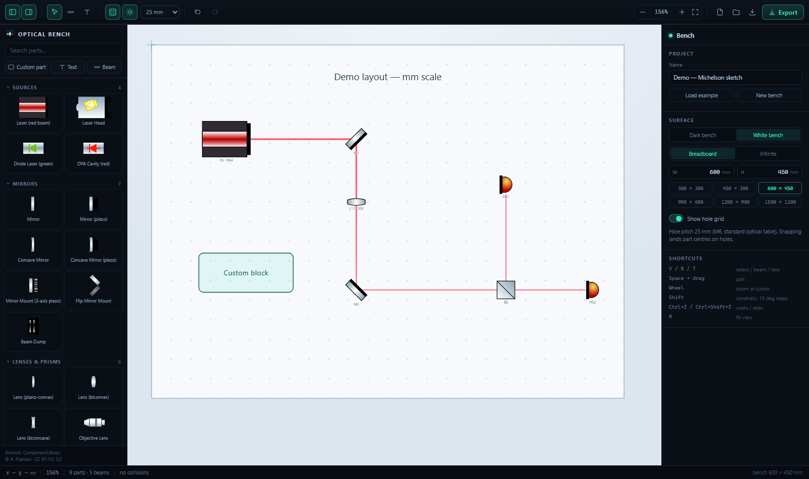

**English** | [中文](README.md)

# Optical Bench — 2D optical table layout designer

A desktop-class web app for arranging components *before* you build the real setup: true mm scale,
25 mm hole grid, alignment snapping between parts, footprint collision detection, gradient-glow beams,
vector / high-resolution export, and a 3D data format intended for Blender.

Since v1.3.2 it also **traces beams automatically**: lasers and fibre couplers emit, mirrors fold,
lenses focus, beamsplitters split, detectors terminate — and the beam diameter follows Gaussian
propagation. Move any part and every path is recomputed immediately.



> The model (thin lens + Gaussian beam formulas), orientation conventions and known limitations are in
> [docs/AUTO-BEAMS.md](docs/AUTO-BEAMS.md) (Chinese).



> The white "print" canvas (`docs/screenshot-light.png`):



> A 4× PNG export, no UI chrome, cropped to content: `docs/export-example.png`

## How this was built

This project is developed with the assistance of **DSH (DeepSeek Harness)**. From the v1.0 SVG canvas
and the component-library clean-up script, through the v1.3 Gaussian beam tracer and the export
pipeline, to the v1.3.2 native macOS shell (Swift + `WKWebView`) and today's two-platform build,
regression-test and release scripts, it is a collaboration between the author and DSH: the author owns
the physics model, component selection, hands-on acceptance testing and product judgement; DSH writes
the implementation, refactors and documentation. Individual lines are not attributed, but that is the
overall attribution.

## Getting it running

Both platforms share **one front-end codebase** (`src/`). They differ only in how that code is wrapped
into a double-clickable window: macOS has a native Swift shell, Windows currently uses
"local server + borderless Edge window". Why it is organised this way — and how a native Windows shell
would be added — is explained in [docs/PLATFORMS.md](docs/PLATFORMS.md) (Chinese).

| Platform | Entry point | What you get |
| --- | --- | --- |
| **macOS (recommended)** | `npm run app:build`, then drag `build/Optical Bench.app` into Applications | Native app, 952 KB, ~0.2 s cold start, native save dialogs — see [docs/MACOS-APP.md](docs/MACOS-APP.md) |
| macOS (no bundling) | Double-click `Optical Bench.command` | Local server + Safari window — see [docs/MACOS-SAFARI.md](docs/MACOS-SAFARI.md) |
| **Windows** | Double-click `Optical Bench.bat` | Local server + Edge `--app` borderless window; native shell still to do, the slot is reserved: [windows/](windows/README.md) |

The launchers for the two no-bundling paths (`.command` / `.bat`) will:

1. start a local static server in the background (`node scripts/serve.mjs`, port 5180);
2. open `http://127.0.0.1:5180/`. On Windows this pops up a chromeless Edge window via `--app`;
   on macOS it opens **Safari** by default (Safari has no `--app` mode — see "standalone window" below).

Closing the console window titled "Optical Bench server" (a terminal window on macOS) quits the app.

> On the first double-click, if `dist/` does not exist the script runs `npm run build` once.
> After that, source changes only show up in that window after a manual `npm run build`
> (use the dev mode below while you are editing code).

**macOS standalone window (optional, still no bundling)**: open `http://127.0.0.1:5180/` in Safari,
then File → Add to Dock… (Safari 17+). You get a Dock icon that opens a window with no address bar and
no tabs — close to a native app, with no signing or packaging involved.
To make the script use a Chrome/Edge `--app` window instead:
`OB_BROWSER=chrome node scripts/serve.mjs --open`.

**Developing**:

```bash
npm install
npm run dev          # http://127.0.0.1:5180 , hot reload
```

**Another port**: `node scripts/serve.mjs --port=5199 --open`.

> There is no Electron shell, so "desktop app" = a local server + one borderless browser window.
> If the port is already taken (say the dev server is running), the launcher simply opens the existing
> server instead of failing. For a real `.exe` installer, wrap this in electron + electron-builder —
> the UI code does not have to change.

## Controls

| Action | Effect |
| --- | --- |
| Left-click a library entry | Drop that component in the centre of the canvas |
| Drag | Move; `Shift` locks to horizontal / vertical |
| With a multi-selection | Six alignment buttons appear on the right: left/centre/right, top/middle/bottom |
| `Ctrl` + drag | Duplicate while dragging (the original stays put) |
| `Alt` + drag | Temporarily disable grid snapping |
| Corner handles / top dot | Resize / rotate; `Shift` keeps aspect ratio or steps by 15° |
| Drag a label | Move the label alone, independent of the component's rotation |
| Drag on empty canvas | Rubber-band selection |
| `V` / `B` / `T` | Select / draw beam / insert text |
| Drawing a beam | Pick the beam tool and drag; endpoint handles adjust it afterwards; `Shift` constrains to 0/45/90°; `Alt` disables snapping |
| Scroll wheel | Zoom around the cursor |
| Space-drag / middle-drag / right-drag | Pan the canvas |
| Arrow keys | Nudge by 1 mm; `Shift` nudges by one snap step |
| `Delete` | Delete; `Ctrl+D` duplicates; `Ctrl+C/V` copy-paste |
| `Ctrl+Z` / `Ctrl+Shift+Z` | Undo / redo |
| `Ctrl+S` / `Ctrl+O` | Save / open `.osopt.json` |
| `0` | Zoom to fit content |
| Double-click text | Edit it in place on the canvas |

With nothing selected the right panel shows **Bench** settings: project name, dark/white canvas,
breadboard size presets, infinite grid vs finite breadboard, grid visibility, load the sample. Once a
component or beam is selected it becomes the property panel, and every number can be typed in directly.

The two buttons at the top left collapse the left and right sidebars, letting the canvas fill the window.

## Size and coordinates

* World units are **mm**; 1 unit = 1 mm; the y axis points down (SVG convention).
* Grid pitch is 25 mm (standard M6 hole spacing); hole coordinates are integer multiples of 25.
* Snapping is **a per-component switch** (property panel → Object → Snap to hole grid), on by default
  for newly placed parts. The grid step is chosen in the toolbar (25 / 12.5 / 5 / 1 mm).
  `Alt` temporarily disables all snapping.
* Alignment between components uses the six buttons that appear on a multi-selection
  (left/centre/right, top/middle/bottom); there is no auto-snapping while dragging.
* Zoom range is 3 %–6000 % (1 px/mm = 100 %); at low zoom the grid is decimated automatically so it
  does not smear into a solid block.
* Default component sizes come from the real dimensions in the graphics library (a mirror is
  10.7 × 29.1 mm), so a dropped part is already life-size. Width and height can be changed freely —
  resizing is a free stretch, aspect ratio is not locked.

## Dark / white canvas

The sun/moon button in the toolbar (or Dark bench / White bench in the Bench panel) switches the
drawing background. Switching to white automatically moves the grid, breadboard fill, component labels
and text boxes to the dark end of the palette — no manual recolouring; the original colours stay in the
file and are restored when you switch back to dark.

If you export onto a white background, text colours are darkened by the same rule, so you never get
white-on-white.

## Collision detection

Every component takes part by default. Its footprint is its rotated rectangle (OBB) and pairs are
tested with the separating-axis theorem — a few milliseconds for a full board. A conflict shows as a
red dashed outline on the canvas, the status bar shows how many, and the right panel lists the
offending pairs; click one to jump to it. Text does not take part, and switching a component's
"Collision check" off excludes it.

Note that this only answers "do two footprints overlap" — it cannot answer "is the beam blocked".
That still needs your eyes.

## Beams

A beam = a straight segment + start aperture + end aperture + colour + opacity. Different apertures mean
diverging / converging; the property panel shows the length and half-angle, and **both length and angle
can be typed in** (changing the length moves only the end point; changing the angle rotates around the
start point).

Rendering is three concentric quadrilaterals (full width / 0.6 / 0.28) with a linear gradient across
each, perpendicular to the optical axis: solid in the middle, fully transparent at the edges, with the
innermost layer blended towards white — close to a real Gaussian spot. On the white canvas the core is
harder so the beam does not turn into a pink smear. The exported SVG stays pure vector, so it never
goes soft at any size.

## Export

* **PNG** at 2× / 4× / 8× (i.e. 2 / 4 / 8 px per mm). A 600 × 450 mm board at 8× is 4800 × 3600 px.
* **SVG**: units written as mm, `viewBox` cropped to content — true physical size in any vector tool,
  infinitely scalable.
* **Copy to clipboard**: paste straight into PowerPoint / Word.
* **Background**: dark / white / transparent. Defaults to the current canvas (a white canvas exports
  white); the white option also recolours the breadboard fill, grid and text for a light background.
* **Options**: include the grid, export only the selection.

Export works by cloning the live SVG stage → stripping the editor chrome → resetting the `viewBox` →
serialising or rasterising, so it is genuinely WYSIWYG. The PNG is re-rasterised at the target
resolution, not an upscaled screen grab.

## Component library

The graphics come from Alexander Franzen's
[ComponentLibrary](https://www.gwoptics.org/component_library/) (CC BY-NC 3.0): 65 pure-vector
components drawn at true mm scale. Plus a hand-drawn objective (`assets/parts/x-objective.svg`,
48 × 30 mm, matching stroke + gradient style) — 66 in total.

These SVGs are Illustrator exports carrying a DOCTYPE with entities and private `a:` / `i:` namespaces.
Browsers render them fine when inlined, but as standalone XML documents they are **not well-formed**
(e.g. `<a:midPointStop/>` becomes an undeclared prefix once `xmlns:a` is gone). So a build-time script
washes them into clean SVG:

```bash
npm run gen     # scripts/gen-library.mjs -> src/generated/library.ts
```

The script strips the DOCTYPE / entities / metadata, removes private-namespace elements and attributes,
checks tag pairing, then compresses each component into a single string constant. At render time every
instance gets a prefixed `id` (`url(#…)` references are rewritten with it), so the same component can be
placed any number of times without gradient IDs colliding.

**Adding your own component**: drop an SVG into `assets/parts/` (the file name becomes the key, e.g.
`x-xyz.svg`), run `npm run gen` once, then add one line with a name and category to
`src/model/catalog.ts`.

`src/model/catalog.ts` contains nothing but English names, categories and search aliases.
The `c-opa*` group (cc/fc/ff/plates/kerr) is a set of nonlinear-cavity bodies named by guessing from
their artwork; if that does not match how you actually use them, just edit the `name` there — nothing
else depends on it.

## Data format and the Blender interface

Project file, `.osopt.json`:

```jsonc
{
  "schema": "optical-setup/1",
  "board": { "mode": "plate", "w": 600, "h": 450, "showGrid": true, "pitch": 25 },
  "items": [
    { "id": "s1", "kind": "lib", "lib": "c-laser1", "x": 95, "y": 120, "rot": 0,
      "w": 61.7, "h": 46.1, "label": "DL 1064", "showLabel": true,
      "locked": false, "collide": true, "z": 25.4 }
  ],
  "beams": [
    { "id": "b1", "x1": 126, "y1": 120, "x2": 254, "y2": 120,
      "w1": 4, "w2": 4, "color": "#ff2f4a", "opacity": 1, "z": 25.4 }
  ]
}
```

The 3D-ready fields are already in place: `z` (optical axis height above the table, default 25.4 mm),
`model3d` (reserved for imported model assets) and `rot` (rotation about z). **3D scene JSON** in the
export menu emits:

```jsonc
{
  "schema": "optical-bench/scene3d/1",
  "unit": "mm",
  "axes": { "x": "table right", "y": "table down (screen)", "z": "up from table surface" },
  "table": { "mode": "plate", "width": 600, "height": 450, "holePitch": 25 },
  "resources": [],
  "items": [{ "id": "s1", "source": "c-laser1", "position": [95, 120, 25.4],
              "rotationDeg": 0, "size": [61.7, 46.1, null], "model3d": null }],
  "beams": [{ "a": [126, 120, 25.4], "b": [254, 120, 25.4],
              "diameterA": 4, "diameterB": 4, "color": "#ff2f4a" }]
}
```

On the Blender side you only need an add-on that reads this JSON, looks up GLB/OBJ assets by `source`,
and places them by `position` / `rotationDeg`. Note that y points to −y in Blender, so flip that sign.

**Not implemented yet**: asset import management (an "add resource" panel), port coordinates (`ports`),
and visualising the Z height. The data structure has room for them, so implementing them will not
require changing existing files.

## Layout

```
src/
  model/        types.ts (scene model) · catalog.ts (component names + categories) · sample.ts (demo layout)
  store.ts      zustand: project, selection, view, undo stack
  lib/          geom.ts (geometry + colour adaptation) · theme.ts · conflicts.ts · export.ts · persist.ts
                native.ts (bridge to a native app; a no-op in the browser) · platform.ts (⌘/Ctrl labels)
  components/   Stage.tsx (canvas + interaction) · Palette.tsx · Inspector.tsx · Toolbar.tsx …
  generated/    library.ts (script-generated, do not edit by hand)
macos/
  src/main.swift            native shell: window, menus, flush before quit
  src/NativeBridge.swift    JS↔Swift bridge: save/open panels, autosave file, clipboard
  src/WebSchemeHandler.swift serves Contents/Resources/web over opticalbench://
  Info.plist                version placeholders, substituted at build time
windows/
  README.md         state of the Windows shell and what is reserved (no native shell yet, see docs/PLATFORMS.md)
scripts/
  gen-library.mjs   component-library clean-up (including the hand-drawn parts in assets/parts)
  make-icon.mjs     renders assets/icon.svg into app.ico + app.iconset
  build-mac-app.sh  one command → Optical Bench.app + .dmg (the main path since v1.3.0)
  make-mac-app.mjs  the old .app packer (shell launcher, superseded by build-mac-app.sh)
  browser-path.mjs  finds Chrome/Edge on any platform
  serve.mjs         dependency-free static server + opens a standalone window
  ui-test.mjs       Playwright interaction regression (v1.0 features)
  ui-test-v11.mjs   Playwright interaction regression (v1.1 features)
assets/
  icon.svg          app icon source
  app.ico           generated by npm run icon
  parts/*.svg       hand-drawn components
Optical Bench.bat     double-click launcher (Windows, no install)
Optical Bench.command double-click launcher (macOS, the no-bundling Safari path)
LICENSE               MIT (code and documentation only, not the component graphics)
AGENTS.md             development conventions: commands, hard rules, coordinates and orientations
STATE.md              current state, settled decisions and next steps (handover notes, synced across machines)
LOG.md                decision and attempt log, append-only (newest first)
MIGRATION-TO-MACOS.md the macOS migration brief
Draw Simple Optical Setup.md  the original requirements note (feature list written before v1.0)
docs/PLATFORMS.md     how macOS and Windows live in one repo, release flow, bridge contract
docs/MACOS-APP.md     building the native macOS app, measured size/startup, known limits
docs/MACOS-SAFARI.md  the no-bundling (Safari) path
```

## Regression tests

```bash
npm run dev          # one terminal
npm run test:ui      # another terminal: three suites, 78 checks in total
                     #   26 interaction (drag/zoom/rotate/beam drawing/export/save)
                     #   25 new features (white canvas, labels, snapping, panels)
                     #   27 optics engine (reflection/lens focus/splitting/detector/wavelength colours)
```

By default it uses the system Edge; `EDGE_PATH` points it at another Chromium.

On macOS without Chromium you can run the same assertions on Playwright's bundled engines
(`npx playwright-core install webkit chromium` once):

```bash
PW_ENGINE=webkit EDGE_PATH="$(ls -d ~/Library/Caches/ms-playwright/chromium-*/chrome-mac-arm64/*.app/Contents/MacOS/*)" npm run test:ui
```

`PW_ENGINE=webkit` runs the same engine Safari uses (WebKit), which is the hardest available signal on
whether Safari has regressed. To run only the optics suite: `npm run test:optics` (also honours
`PW_ENGINE=webkit`).

After changing the icon source: `npm run icon` regenerates `assets/app.ico`.

## Known limitations

* Beams are independent segments; they do not break at components, so one optical path has to be drawn
  as several pieces. Chaining segments into one path is planned.
* Collision detection only considers rectangular footprints, ignoring height differences (e.g. a tall
  mirror mount passing over a low lens).
* Component artwork is "front view" style: rotating to 45° rotates the whole drawing rather than drawing
  a tilted mount.
* Manually exporting a dark canvas onto a white background keeps the dark-canvas beam palette, which
  looks washed out; switch the canvas to White bench first to get the white-background palette.
* No Electron shell / installer yet.

## Licence

**The code is MIT, the component graphics are CC BY-NC — two separate things, do not conflate them.**

* **Code and documentation**: [MIT](LICENSE), Copyright (c) 2026 zzrtbf. Use it, modify it, redistribute
  it freely, **commercial use included**, as long as the copyright and permission notice are kept. The
  software is provided "as is", without warranty of any kind.
* **Component graphics**: ComponentLibrary by Alexander Franzen, **CC BY-NC 3.0**
  (Attribution–NonCommercial). The author explicitly waives attribution when the library is used to
  create a small number of illustrations for a new work, but distributing this software or using the
  library for a major part of a larger work requires attribution. `ComponentLibrary_files/` and
  `src/generated/library.ts` fall under that licence; the app credits it in the UI.

In other words: **`LICENSE` does not cover the graphics in `ComponentLibrary_files/` or
`src/generated/library.ts`.** Using the whole program commercially requires separate permission from
Alexander Franzen.

> The deep-dive documents under `docs/` exist only in Chinese.

This file is maintained by hand alongside [README.md](README.md). GitHub has no built-in language
switch, so the two are kept in step by editing both whenever a feature changes.

---

[中文版 README](README.md)
