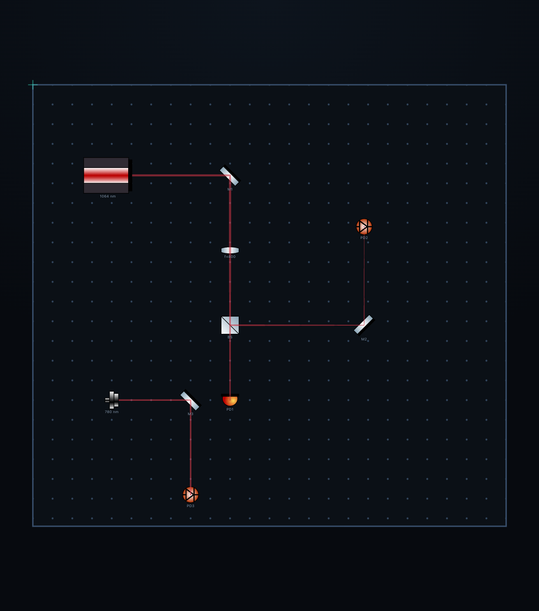
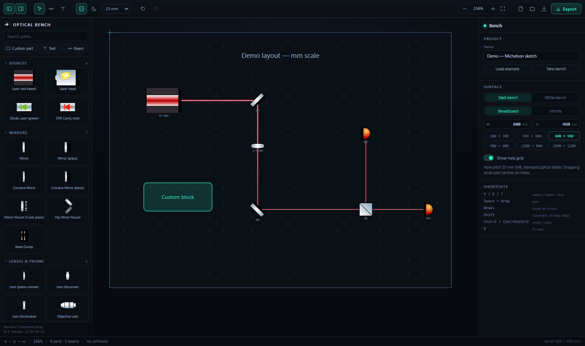
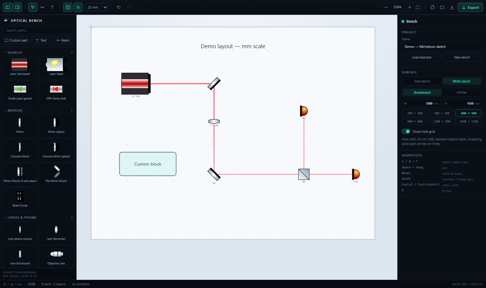

[English](README.en.md) | **中文**

# Optical Bench — 2D 光路排布设计器

用来在搭光路之前排布器件的桌面级 Web 应用：真实 mm 刻度、25 mm 孔阵、器件间对齐吸附与
占位冲突检测、带渐变光晕的光束、矢量/高清导出，并预留了导出到 Blender 的 3D 数据格式。

从 v1.3.2 起还能**自动追迹光路**：激光和光纤耦合器发光，经反射镜折转、透镜聚焦、分束器分光，
到探测器截止，光束直径按高斯光束演化。挪动任一器件，光路立刻重算。



> 模型（薄透镜 + 高斯光束的公式）、器件朝向约定与已知限制见 [docs/AUTO-BEAMS.md](docs/AUTO-BEAMS.md)。



> 白色「打印」版画布（`docs/screenshot-light.png`）：



> 导出的 4× PNG（无界面元素，按内容裁剪）：`docs/export-example.png`

## 开发方式

这个项目是在 **DSH（DeepSeek Harness）** 的辅助下开发的：从 v1.0 的 SVG 画布与器件库清洗脚本，
到 v1.3 的高斯光束自动追迹、导出管线，再到 v1.3.2 的 macOS 原生外壳（Swift + `WKWebView`）
和现在这套双平台构建 / 回归测试 / 发版脚本，都是作者与 DSH 协作完成的——作者负责物理模型、
器件选型、实测验收与产品判断，DSH 负责实现、重构与文档。代码里没有再逐行区分「谁写的」，
但整体归因如此。

## 怎么打开

两个平台共用**同一份前端源码**（`src/`），差别只在「怎么把它变成一个能双击的窗口」：
macOS 有原生 Swift 外壳，Windows 目前走「本地服务器 + Edge 无边框窗口」。
为什么这样组织、将来怎么给 Windows 补原生壳，见 [docs/PLATFORMS.md](docs/PLATFORMS.md)。

| 平台 | 入口 | 形态 |
| --- | --- | --- |
| **macOS（推荐）** | `npm run app:build`，把 `build/Optical Bench.app` 拖进「应用程序」 | 原生 App，952 KB、冷启动约 0.2 秒、原生保存对话框——见 [docs/MACOS-APP.md](docs/MACOS-APP.md) |
| macOS（免打包） | 双击 `Optical Bench.command` | 本地服务器 + Safari 窗口——见 [docs/MACOS-SAFARI.md](docs/MACOS-SAFARI.md) |
| **Windows** | 双击 `Optical Bench.bat` | 本地服务器 + Edge 的 `--app` 无边框窗口；原生壳待做，位置已预留：[windows/](windows/README.md) |

免打包的两条路（`.command` / `.bat`）的启动器会：

1. 在后台起一个本地静态服务器（`node scripts/serve.mjs`，端口 5180）；
2. 打开 `http://127.0.0.1:5180/`。Windows 上用 Edge 的 `--app` 模式弹出无地址栏的独立窗口；
   macOS 上默认拉 **Safari**（Safari 没有 `--app` 模式，见下面「独立窗口」一段）。

关掉那个标题为 "Optical Bench server" 的控制台窗口（macOS 上是终端窗口）= 退出软件。

> 第一次双击时如果 `dist/` 不存在，脚本会自动 `npm run build` 一次。
> 之后改了源码，需要手动 `npm run build` 才会反映到这个窗口（改代码调试请用下面的 dev 模式）。

**macOS 想要独立窗口（可选，不用打包）**：在 Safari 里打开 `http://127.0.0.1:5180/`，
然后「文件 → 添加到程序坞…」（Safari 17+）会生成一个独立的 Web App 图标，双击直接开窗口、
不显示地址栏和标签页，效果接近原生 App，且不涉及签名和打包。
想让脚本改走 Chrome/Edge 的 `--app` 窗口：`OB_BROWSER=chrome node scripts/serve.mjs --open`。

**改代码调试**：

```bash
npm install
npm run dev          # http://127.0.0.1:5180 ，热更新
```

**换端口**：`node scripts/serve.mjs --port=5199 --open`。

> 没有套 Electron 外壳，所以「桌面应用」= 一个本地服务器 + 一个无边框浏览器窗口。
> 端口被占用时（比如 dev 服务器正开着），启动脚本会直接打开那个已有服务，不会报错。
> 要真正的 .exe 安装包，再套 electron + electron-builder 即可，UI 代码不用动。

## 操作

| 操作 | 说明 |
| --- | --- |
| 左键点器件库 | 在画布中心放一个器件 |
| 拖动 | 移动；Shift 锁水平/垂直 |
| 多选后 | 右侧面板出现左/中/右、上/中/下六个对齐按钮 |
| `Ctrl` + 拖动 | 拖动复制（原器件留在原地） |
| `Alt` + 拖动 | 临时关掉网格吸附 |
| 四角手柄 / 顶部圆点 | 缩放 / 旋转；Shift 等比或 15° 步进 |
| 拖动标签 | 标签单独移动，不跟器件旋转 |
| 空白处拖动 | 框选 |
| `V` / `B` / `T` | 选择 / 画光束 / 插文本 |
| 画光束 | 选光束工具后拖一条；端点手柄可再调整；Shift 约束 0/45/90°；Alt 不吸附 |
| 滚轮 | 以光标为中心缩放 |
| 空格拖动 / 中键 / 右键拖动 | 平移画布 |
| 方向键 | 微移 1 mm，Shift 一档吸附步长 |
| `Delete` | 删除；`Ctrl+D` 复制；`Ctrl+C/V` 复制粘贴 |
| `Ctrl+Z` / `Ctrl+Shift+Z` | 撤销 / 重做 |
| `Ctrl+S` / `Ctrl+O` | 保存 / 打开 `.osopt.json` |
| `0` | 缩放到适合内容 |
| 双击文本 | 就地在画布上编辑 |

没选中任何东西时，右侧面板是「Bench」设置：工程名、深色/白色画布、面包板尺寸预设、
无限点阵 / 有限面包板、点阵显隐、加载示例。选中器件/光束后变成属性面板，所有数值都能直接输入。

顶部左侧两个按钮可以把左右侧栏收起来，画布占满整块区域。

## 尺寸与坐标

* 世界坐标单位是 **mm**，1 单位 = 1 mm；y 轴向下（SVG 习惯）。
* 点阵间距 25 mm（M6 标准孔距），孔的坐标是 25 的整数倍。
* 吸附是**每个器件自己的开关**（属性面板 → Object → Snap to hole grid），
  新放的器件默认打开；网格步长在工具栏选（25 / 12.5 / 5 / 1 mm）。`Alt` 临时关掉一切吸附。
* 器件之间的对齐用多选后的六个对齐按钮（左/中/右、上/中/下），拖动时不做自动吸附。
* 缩放范围 3 %–6000 %（1 px/mm = 100 %），低缩放时点阵自动抽稀，避免糊成一片。
* 器件默认尺寸取自图形库里的真实尺寸（例如镜子 10.7 × 29.1 mm），插进去就是实物大小；
  可以随意改宽高 —— 缩放是自由拉伸，不锁比例。

## 深色 / 白色画布

工具栏的太阳/月亮按钮（或 Bench 面板的 Dark bench / White bench）切换绘图背景。
切到白色后，点阵、面包板底色、器件标签、文本框颜色都会自动转到深色系，
不需要手工改颜色——原色依然存在文件里，切回深色会复原。

导出时如果选白色背景，文本颜色也会按同样规则自动加深，不会出现"白字白底"。

## 冲突检测

每个器件默认参与检测，足迹就是它的旋转矩形（OBB），用分离轴定理两两判交，几毫秒内完成。
冲突时画布上是红色虚线框，状态栏显示数量，右侧列出冲突对象、点击可定位。
文本不参与检测；器件的「Collision check」关掉后不参与。

注意它只能回答"两个器件的占地是否重叠"，不能回答"光是否被挡住"——后者还是得看。

## 光束

一条光束 = 一段直线 + 起点口径 + 终点口径 + 颜色 + 不透明度。
口径不同就是发散/汇聚，属性面板里给出长度和半张角，**长度和角度都能直接输入**
（改长度只动终点，起点不动；改角度是绕起点转）。

渲染是三层同心四边形（全宽 / 0.6 / 0.28 倍），每层沿垂直于光轴的方向做线性渐变：
中间最实、边缘全透明，最内层混白，看上去接近真实高斯光斑。白底画布上换成更硬的核心，
免得整条光变成一片粉。导出成 SVG 后仍是纯矢量，放到多大都不会糊。

## 导出

* **PNG** 2× / 4× / 8×（即 2 / 4 / 8 px per mm）。600 × 450 mm 的板子 8× 出 4800 × 3600 px。
* **SVG**：单位写成 mm，`viewBox` 按内容裁剪，任何矢量软件里都是真实尺寸，可无限放大。
* **复制到剪贴板**：直接贴进 PPT / Word。
* **背景**：深色 / 白色 / 透明。默认跟随当前画布（白底画布就默认导出白底），
  白色会把面包板底色、点阵和文字颜色一起改成浅底适配的版本。
* **选项**：包含点阵、只导出选中对象。

导出走的是"克隆当前 SVG 舞台 → 剥掉编辑器装饰 → 重设 viewBox → 栅格化"，
所以所见即所得；PNG 是在目标分辨率下重新栅格化的，不是把屏幕截图放大。

## 器件库

图形来自 Alexander Franzen 的
[ComponentLibrary](https://www.gwoptics.org/component_library/)（CC BY-NC 3.0），
65 个纯矢量器件，按真实 mm 尺度绘制；再加上自己画的物镜（`assets/parts/x-objective.svg`，
48 × 30 mm，同样的描边+渐变风格），一共 66 个。

这些 SVG 是 Illustrator 导出的，带 DOCTYPE 实体和 `a:`/`i:` 私有命名空间，浏览器内联
渲染时没问题，但作为独立 XML 文档是**不合法**的（例如 `<a:midPointStop/>` 在删掉
`xmlns:a` 之后就成了未声明前缀）。所以有一个构建期脚本把它们洗成干净 SVG：

```bash
npm run gen     # scripts/gen-library.mjs -> src/generated/library.ts
```

脚本会：剥 DOCTYPE/实体/metadata、删私有命名空间元素与属性、校验标签配对，然后把每个器件
压成一条字符串常量。渲染时按实例给 `id` 加前缀（`url(#...)` 一起改），所以同一个器件放
多少个都不会互相污染渐变。

**加自己的器件**：把 SVG 丢进 `assets/parts/`（文件名就是 key，例如 `x-xyz.svg`），
`npm run gen` 一次，再在 `src/model/catalog.ts` 里加一行名字/分类即可。

`src/model/catalog.ts` 里是中文之外再没有的东西：英文名、分类、搜索别名。
`c-opa*` 那一组（cc/fc/ff/plates/kerr）是按图形推断命名的非线性腔体，如果和你实际用法不符，
直接改那里的 `name` 就行，不影响其它逻辑。

## 数据结构与 Blender 接口

工程文件 `.osopt.json`：

```jsonc
{
  "schema": "optical-setup/1",
  "board": { "mode": "plate", "w": 600, "h": 450, "showGrid": true, "pitch": 25 },
  "items": [
    { "id": "s1", "kind": "lib", "lib": "c-laser1", "x": 95, "y": 120, "rot": 0,
      "w": 61.7, "h": 46.1, "label": "DL 1064", "showLabel": true,
      "locked": false, "collide": true, "z": 25.4 }
  ],
  "beams": [
    { "id": "b1", "x1": 126, "y1": 120, "x2": 254, "y2": 120,
      "w1": 4, "w2": 4, "color": "#ff2f4a", "opacity": 1, "z": 25.4 }
  ]
}
```

3D-ready 的字段已经就位：`z`（光轴高度，桌面以上，默认 25.4 mm）、`model3d`（预留给导入的
模型资源）、`rot`（绕 z 轴角度）。导出菜单里的 **3D scene JSON** 会输出：

```jsonc
{
  "schema": "optical-bench/scene3d/1",
  "unit": "mm",
  "axes": { "x": "table right", "y": "table down (screen)", "z": "up from table surface" },
  "table": { "mode": "plate", "width": 600, "height": 450, "holePitch": 25 },
  "resources": [],
  "items": [{ "id": "s1", "source": "c-laser1", "position": [95, 120, 25.4],
              "rotationDeg": 0, "size": [61.7, 46.1, null], "model3d": null }],
  "beams": [{ "a": [126, 120, 25.4], "b": [254, 120, 25.4],
              "diameterA": 4, "diameterB": 4, "color": "#ff2f4a" }]
}
```

Blender 侧只需要一个读这个 JSON、按 `source` 查表实例化 GLB/OBJ、按 `position`/`rotationDeg`
摆放的 addon。注意 y 轴在 Blender 里指向 −y 需要自己翻一下符号。

**还没做的**：资源的导入管理（"添加资源"面板）、端口坐标（`ports`）、Z 高度可视化。
数据结构留了位置，实现时不用改已有文件。

## 目录

```
src/
  model/        types.ts（场景模型） · catalog.ts（器件名与分类） · sample.ts（示例布局）
  store.ts      zustand：工程、选择、视图、撤销栈
  lib/          geom.ts（几何 + 颜色适配） · theme.ts · conflicts.ts · export.ts · persist.ts
                native.ts（原生 App 的桥接；浏览器里是 no-op） · platform.ts（⌘/Ctrl 文案）
  components/   Stage.tsx（画布与交互） · Palette.tsx · Inspector.tsx · Toolbar.tsx …
  generated/    library.ts（由脚本生成，不要手改）
macos/
  src/main.swift            原生外壳：窗口、菜单、退出前 flush
  src/NativeBridge.swift    JS↔Swift 桥：保存/打开面板、自动存档文件、剪贴板
  src/WebSchemeHandler.swift 以 opticalbench:// 提供 Contents/Resources/web
  Info.plist                版本占位，构建时替换
windows/
  README.md         Windows 壳的现状与预留说明（原生壳尚未实现，见 docs/PLATFORMS.md）
scripts/
  gen-library.mjs   器件库清洗（含 assets/parts 里自己画的器件）
  make-icon.mjs     把 assets/icon.svg 渲染成 app.ico + app.iconset
  build-mac-app.sh  一条命令产出 Optical Bench.app + .dmg（v1.3.0 起的主路径）
  make-mac-app.mjs  旧版 .app 打包脚本（shell 启动器，已被 build-mac-app.sh 取代）
  browser-path.mjs  跨平台找 Chrome/Edge
  serve.mjs         无依赖静态服务器 + 打开独立窗口
  ui-test.mjs       Playwright 交互回归（v1.0 功能）
  ui-test-v11.mjs   Playwright 交互回归（v1.1 新功能）
assets/
  icon.svg          应用图标源文件
  app.ico           由 npm run icon 生成
  parts/*.svg       自己画的器件
Optical Bench.bat     双击启动（Windows，免安装）
Optical Bench.command 双击启动（macOS，免打包的 Safari 路径）
README.en.md          英文版 README（与本文对应，改功能时两边一起改）
MIGRATION-TO-MACOS.md macOS 迁移任务书
Draw Simple Optical Setup.md  最初的需求书（v1.0 之前写下的功能清单）
docs/PLATFORMS.md     双平台（macOS / Windows）在一个仓库里的组织方式、发版流程、桥接口约定
docs/MACOS-APP.md     macOS 原生 App 的构建、体积/启动实测与已知限制
docs/MACOS-SAFARI.md  macOS 免打包（Safari）路径说明
```

## 回归测试

```bash
npm run dev          # 一个终端
npm run test:ui      # 另一个终端：三套共 78 项
                     #   26 交互（拖拽/缩放/旋转/画光束/导出/保存）
                     #   25 新功能（白底、标签、吸附、面板）
                     #   27 光学引擎（反射/透镜聚焦/分束/探测器/波长配色）
```

默认用系统里的 Edge，`EDGE_PATH` 环境变量可以换别的 Chromium。

macOS 上没有 Chromium 时，可以用 Playwright 自带的引擎跑同一套断言（`npx playwright-core install webkit chromium` 一次即可）：

```bash
PW_ENGINE=webkit EDGE_PATH="$(ls -d ~/Library/Caches/ms-playwright/chromium-*/chrome-mac-arm64/*.app/Contents/MacOS/*)" npm run test:ui
```

`PW_ENGINE=webkit` 跑的是 Safari 同一个引擎（WebKit），是判断 Safari 上有没有退化的最硬指标。
只跑光学引擎那一套：`npm run test:optics`（同样支持 `PW_ENGINE=webkit`）。

改了图标源文件后：`npm run icon` 重新生成 `assets/app.ico`。

## 已知限制

* 光束是独立线段，不会在器件处自动断开；一条光路要画成几段。多段串成一条在计划里。
* 冲突检测只按矩形足迹，不考虑器件高度差（比如一根高镜架从另一颗低透镜上方跨过去）。
* 器件库的图形是"正视图"风格，转到 45° 时是整张图在转，不会真的画出斜置的镜架。
* 深色画布手动导出成白色背景时，光束仍是深色画布那套配色，会显得偏淡；
  把画布切成 White bench 再导出就是白底专用配色。
* 还没有 Electron 外壳 / 安装包。

## 许可

* **器件图形**：ComponentLibrary by Alexander Franzen，**CC BY-NC 3.0**（署名—非商业性使用）。
  用于论文/网页的少量插图时作者明确放弃署名要求，但分发本软件或大篇幅使用时需保留署名——
  `ComponentLibrary_files/` 与 `src/generated/library.ts` 都在这个授权范围内，界面上已注明。
* **其余代码**：作者保留所有权利，暂未附加开源许可。如果希望别人能自由复用，加一个
  LICENSE（例如 MIT）即可——代码这边没有第三方限制。
