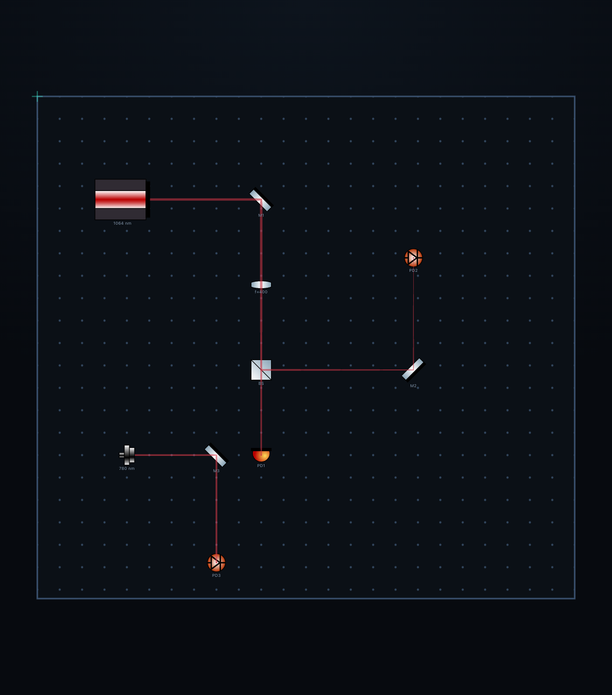

# 自动光路追迹（v1.3.2）

在画布上摆好激光、反射镜、透镜、分束器和探测器，打开工具栏的光束开关，光路会按几何光学 +
高斯光束自动画出来；挪动任何一个器件，光路立刻重算。

上图中 1064 nm 激光经 M1 折转、过 f=400 透镜后在 BS 处分成两臂，分别落在 PD1 / PD2；
780 nm 光纤耦合器单独一路经 M3 落在 PD3。**光路是算出来的，不是画出来的**——没有存进工程文件，
改布局就跟着变。

## 怎么用

1. 放一个 **Laser**（`c-laser1` / `c-laser2` / `c-diodegrn`）或 **Fiber Coupler Mount**（`b-coupler`）；
2. 选中它，右侧面板出现 **LIGHT SOURCE** 分组：
   - `Emit light` 开关：关掉就不发光；
   - 耦合器还可以选 `Collimate (out)` / `Couple (in)`；
   - `λ` 波长（nm），下面一排常用谱线按钮：405 / 461 / 532 / 633 / 780 / 852 / 1064 / 1550；
   - `Ø` 出射光束直径（mm，准直），`Opacity` 绘制透明度；
3. 器件朝**本地 +x** 发射，用旋转（`Rot`，或拖旋转手柄）瞄准；
4. 工具栏的**光束按钮**控制自动光路的显示/隐藏（随工程保存）。

光束颜色由波长决定，见下面「颜色」一节。

## 物理模型

2D、傍轴、矩阵光学的标准做法。记光轴传播距离 $z$，束腰 $w_0$，瑞利长度

$$z_R = \frac{\pi w_0^2}{\lambda}$$

复参数 $q$ 满足 $\frac{1}{q} = \frac{1}{R} - i\frac{\lambda}{\pi w^2}$，于是任意点的束宽

$$w(z) = \sqrt{-\frac{\lambda}{\pi\,\mathrm{Im}(1/q)}}$$

三种操作：

| 操作 | 公式 |
| --- | --- |
| 自由传播 $d$ | $q \to q + d$ |
| 薄透镜 | $\frac{1}{q'} = \frac{1}{q} - \frac{1}{f}$（$f>0$ 会聚，$f<0$ 发散） |
| 平面镜 | $\mathbf{d}' = \mathbf{d} - 2(\mathbf{d}\cdot\mathbf{n})\mathbf{n}$，$q$ 不变 |

**出射条件**：准直，束腰在出射面上，$q_0 = i z_R$、$w_0 = \varnothing/2$。所以刚出射时光束既不聚也不散，
只有衍射带来的缓慢扩张（633 nm、2 mm 光束在 500 mm 上只长 0.5%）。

**分束器**：透射支和反射支都**继承同一个 $q$**，因此两支的颜色、直径、发散/会聚完全一致
（你要求的行为）。反射方向由刻线方向决定。

**探测器**：命中即终止，不再传播。

## 器件朝向（重要）

器件的本地坐标约定，旋转量直接叠加：

| 器件 | 有效面 | 说明 |
| --- | --- | --- |
| Laser / 光纤耦合器 | — | 沿本地 **+x** 出射，出射面在器件前沿 |
| Mirror / 凹面镜 / 摆架镜 | 本地 y 方向（竖直短线） | 反射；转 45° 折 90° |
| Lens / Objective | 本地 y 方向 | 薄膜透镜，光轴穿面而过 |
| BS / PBS / 二向色镜 | 画出来的那条对角线 | 45° 分光；旋转可改变反射臂指向 |
| Beam Splitter Cube (`b-bspcube`) | 本地 y（图形是竖直薄片） | 按平板分束处理 |
| Photodetector / QPD | 本地 y | 只有面朝光束才会接到（平行掠过不算） |
| Beam Dump | 本地 y | 吸收，终止 |
| 其他（镜架、电子学、光纤） | — | **透明**，光直接穿过 |

最后一条是刻意的：真实的镜架会挡光，但如果每个支架都挡住光线，图会变得无法使用。
要真正挡住一束光，就放一个 **Beam Dump**。

## 颜色

可见光（380–780 nm）按 CIE 近似取色，所以 633 是红、532 是绿、405 是紫。
**1064 / 1550 这类红外在物理上不可见**，图上用暗红表示并保证可读；780 nm（铷线）在可见边缘，
取深红。波长数值始终显示在面板里，不会把 1064 和 633 混起来。

手绘光束（`B` 工具画的）也用波长选色：选中光束后填波长，颜色跟着变。v1.3.2 之前存的工程
没有波长字段，保持原来的颜色，直到你在面板里选一个波长。

## 已知限制

- **2D 傍轴**：大角度（>20–30°）只是几何近似，不含倾斜入射的余弦因子与像差。
- **薄透镜**：不区分球差/色差；物镜（`x-objective`）本该是多片组，这里当单一薄透镜。
- **平面镜**：凹面镜按平面处理（$q$ 只改方向，不加光焦度）。
- **无偏振、无干涉**：PBS 与普通 BS 一样按 50/50 分光，没有偏振态传播，所以
  「偏振分束」的物理含义目前不成立。
- **无光阑衍射**：光束边缘不因元件尺寸被截断，只按元件高度判断"打没打中"。
- **分束比固定 50/50**（数据里已留 `split` 字段，界面暂未开放）。
- 光束互相不作用（不相干叠加），也不考虑增益/损耗。

这些都可以后续加：偏振态（Jones 向量）、曲面镜、高斯光束的光阑截断、分束比、多波长合成。
